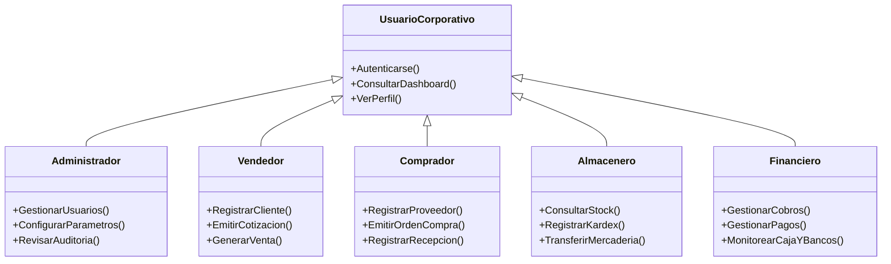

# 02. CASOS DE USO DEL SISTEMA
## ERP EnterpriseCloud — Modelado de Actores y Flujos

---

## 1. Actores del Sistema

---

## 2. Matriz de Casos de Uso Principales

| ID | Caso de Uso | Actor Principal | Precondición | Flujo Básico |
| :--- | :--- | :--- | :--- | :--- |
| **CU-01** | Iniciar Sesión en la Plataforma | Cualquier usuario | Usuario activo en sistema | Ingresar correo y contraseña; backend valida hash, genera JWT y asigna rol en interfaz. |
| **CU-02** | Registrar Venta / Facturación | Vendedor / Admin | Cliente y producto registrados | Seleccionar cliente, agregar líneas de producto, calcular IGV/total, descontar stock en inventario y emitir comprobante. |
| **CU-03** | Emitir Orden y Recepción de Compra | Comprador / Admin | Proveedor registrado | Elaborar orden con precios pactados; al confirmar recepción, se incrementa el stock en almacén y se crea cuenta por pagar. |
| **CU-04** | Transferencia entre Almacenes | Almacenero / Admin | Stock suficiente en origen | Seleccionar almacén origen y destino, definir cantidad y registrar movimiento Kardex de egreso/ingreso. |
| **CU-05** | Cargar Documento al Repositorio Cloud | Cualquier usuario | Archivo PDF válido | Adjuntar archivo digital, asignar entidad comercial; el sistema sube el archivo al bucket Amazon S3 y guarda metadatos en RDS. |
| **CU-06** | Registrar Cobro / Amortización | Financiero / Admin | Factura con saldo pendiente | Seleccionar documento de venta, ingresar monto, método de pago y actualizar saldo del cliente. |
| **CU-07** | Auditoría y Trazabilidad | Administrador | Rol 'admin' | Consultar historial inmutable de acciones realizadas en los módulos con fecha, hora, usuario e IP. |
