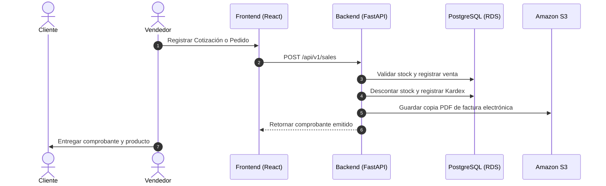
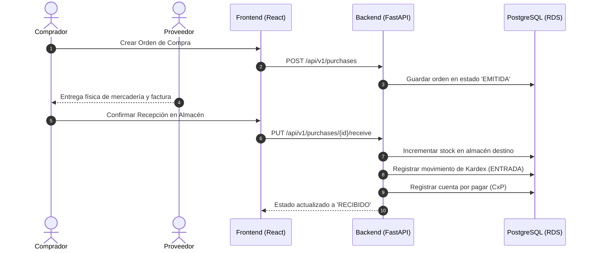
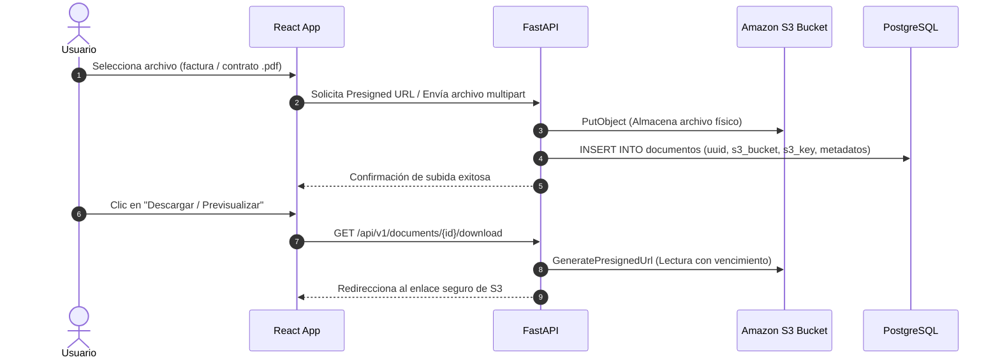

# 03. MAPA Y FLUJOGRAMAS DE PROCESOS EMPRESARIALES
## ERP EnterpriseCloud

---

## 1. Ciclo de Ventas (Order-to-Cash)

---

## 2. Ciclo de Compras (Procure-to-Pay)

---

## 3. Flujo del Repositorio Documental Cloud (Amazon S3)

