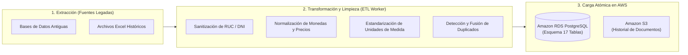

# 04. ESTÁNDARES OPERATIVOS, NORMATIVA LOCAL Y PROCESOS ETL
## ERP EnterpriseCloud

---

## 1. Diseño de Interfaces Resilientes a Conexiones Inestables

Para garantizar la continuidad operativa en sedes remotas, plantas industriales o sucursales con conectividad intermitente:

* **Eliminación de Ventanas Modales Bloqueantes:**
  * En lugar de depender de diálogos modales flotantes (que pueden perder el estado del formulario ante una caída de red o reconexión de WebSocket), el ERP implementa **paneles de edición directa en la misma vista** (paneles plegables laterales o edición directa en celdas de la tabla).
  * Los cambios se almacenan primero en el búfer local del navegador antes de ser sincronizados con el servidor.
* **Restricción de Selectores a Máximo 5 Elementos:**
  * Los selectores desplegables estándar no deben renderizar cientos de nodos en el DOM. Se establece una regla de **máximo 5 elementos directos** para opciones fijas.
  * Para catálogos grandes (clientes, almacenes, productos), se utiliza un componente con **búsqueda predictiva (Typeahead / Autocomplete)** con debounce de 300ms y paginación en servidor.

---

## 2. Estrategia de Carga Masiva: Excel (XLSX) vs. CSV

El proyecto adopta **Microsoft Excel (.xlsx)** como estándar oficial para la ingestión y carga masiva de datos:

| Criterio | Formato CSV tradicional | Estándar XLSX adoptado en el ERP |
| :--- | :--- | :--- |
| **Integridad de Delimitadores** | Propenso a errores cuando los campos contienen comas, guiones o saltos de línea (direcciones, razones sociales). | Inmune a errores de delimitación; utiliza estructura interna XML comprimida y tipada. |
| **Juego de Caracteres** | Problemas frecuentes con tildes, eñes y caracteres especiales según el software de exportación (ANSI vs UTF-8). | Codificación UTF-8 nativa garantizada por la especificación OpenXML. |
| **Relaciones entre Entidades** | Obliga a subir archivos individuales planos y aislados. | **Soporte multi-hoja similar a Power BI:** Un solo libro contiene hojas interrelacionadas (`Clientes`, `Productos`, `Existencias_Iniciales`, `Precios`). |
| **Validación Previa** | Imposible incluir listas desplegables o reglas dentro del archivo. | Permite validación de datos en celdas y fórmulas antes de que el usuario envíe el archivo al sistema. |

---

## 3. Procesos ETL (Extracción, Transformación y Carga) para Sistemas Legados

Para migrar organizaciones con bases de datos antiguas (FoxPro, Access, AS400 o ERPs anteriores) sin degradar el rendimiento:

* **Procesamiento Asíncrono en Background:** El pipeline ETL se ejecuta como tarea en segundo plano mediante tareas desacopladas en el backend (o AWS Glue / Celery Worker), asegurando que la API no bloquee las operaciones cotidianas de facturación y despacho.

---

## 4. Adaptación a Normativas Locales (Perú - SUNAT)

El sistema incorpora validaciones tributarias obligatorias según la normativa de la Superintendencia Nacional de Aduanas y de Administración Tributaria (SUNAT):

1. **Identificadores Tributarios Oficiales:**
   * **RUC (Registro Único de Contribuyentes):** Validación de 11 dígitos numéricos que inicien con prefijos válidos (`10`, `15`, `17`, `20`) aplicando el algoritmo de verificación **Módulo 11**.
   * **DNI:** Validación estricta de 8 dígitos numéricos.
2. **Catálogos de Comprobantes de Pago Electrónicos (CPE):**
   * Tipo `01`: Factura Electrónica.
   * Tipo `03`: Boleta de Venta Electrónica.
   * Tipo `07`: Nota de Crédito Electrónica.
   * Tipo `08`: Nota de Débito Electrónica.
   * Tipo `09`: Guía de Remisión Remitente (vinculada al módulo de Almacenes y Despachos).
3. **Estructura Impositiva:**
   * Cálculo automático del Impuesto General a las Ventas (**IGV al 18%**: 16% IGV + 2% Impuesto de Promoción Municipal IPM).
   * Soporte para operaciones gravadas, exoneradas, inafectas y gratuitas.
   * Control de regímenes de **Retenciones (3%)**, **Percepciones** y **Detracciones (SPOT)** para servicios sujetos al Banco de la Nación.

---

## 5. Auditoría Inteligente y Automatización con IA (AWS Insights)

Aprovechando los servicios cloud de AWS para la supervisión del sistema:

* **Amazon CloudWatch Logs Insights:** Permite ejecutar consultas interactivas sobre millones de registros de logs en tiempo real para rastrear la latencia de endpoints, excepciones no controladas y accesos fuera de horario laboral.
* **Detección Predictiva de Anomalías:** Algoritmos de Machine Learning analizan el flujo habitual de compras y ventas. Si se detecta un descuento fuera del rango autorizado o un desfase inusual en el stock de un almacén, se dispara una alerta preventiva inmediata.
* **Generación de Resúmenes Balanceados con IA:** Módulo de analítica que procesa periódicamente los registros de auditoría y rendimiento para redactar informes ejecutivos para la gerencia, señalando con objetividad las **fortalezas operativas**, los **cuellos de botella** identificados y **planes de acción recomendados**.
