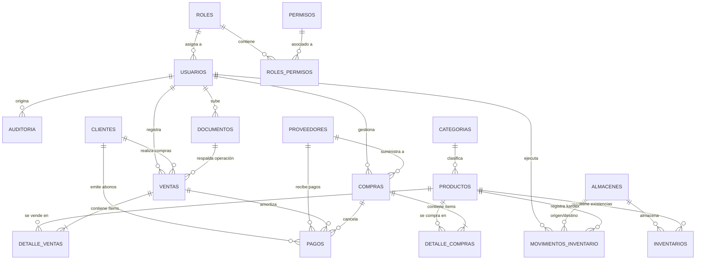

# Modelo Entidad-Relación (DER) — ERP EnterpriseCloud
## Base Académica: Semana 07 (Amazon RDS PostgreSQL)

El siguiente diagrama modela las **17 tablas relacionales** normalizadas que conforman el núcleo de datos del ERP, garantizando integridad referencial, trazabilidad de transacciones y persistencia estructurada.

---

## Diccionario de Tablas e Integridad

| Tabla | Propósito | Llaves Foráneas Principales |
| :--- | :--- | :--- |
| `roles` | Catálogo de perfiles (Admin, Ventas, Compras, Almacén, Finanzas) | Ninguna |
| `permisos` | Acciones atómicas por módulo (`crear`, `aprobar`, `actualizar`) | Ninguna |
| `usuarios` | Cuentas corporativas, autenticación y sesión | `rol_id` -> `roles(id)` |
| `auditoria` | Bitácora inmutable de eventos críticos | `usuario_id` -> `usuarios(id)` |
| `clientes` | Cartera de clientes, RUC/DNI, líneas de crédito y saldos | Ninguna |
| `proveedores` | Proveedores homologados, condiciones comerciales | Ninguna |
| `categorias` | Jerarquía y clasificación de productos | Ninguna |
| `almacenes` | Sedes físicas de almacenamiento (Central, Secundario) | `responsable_id` -> `usuarios(id)` |
| `productos` | Catálogo maestro de bienes y servicios, SKU, precios | `categoria_id` -> `categorias(id)` |
| `inventarios` | Existencias actuales por almacén y stock comprometido | `producto_id`, `almacen_id` (Compuesta) |
| `movimientos_inventario` | Registro Kardex de entradas, salidas, traslados y ajustes | `producto_id`, `almacen_origen_id`, `almacen_destino_id` |
| `ventas` | Cabecera comercial, facturas, cotizaciones, pedidos | `cliente_id`, `usuario_id` |
| `detalle_ventas` | Líneas de comprobante, cantidades y precios unitarios | `venta_id`, `producto_id`, `almacen_id` |
| `compras` | Cabecera de órdenes y facturas de adquisición | `proveedor_id`, `usuario_id` |
| `detalle_compras` | Líneas de adquisición y costos | `compra_id`, `producto_id`, `almacen_id` |
| `pagos` | Movimientos de caja, cuentas por cobrar y pagar | `venta_id`, `compra_id`, `cliente_id`, `proveedor_id` |
| `documentos` | Metadatos de archivos vinculados al bucket de Amazon S3 | `subido_por_usuario_id` -> `usuarios(id)` |
