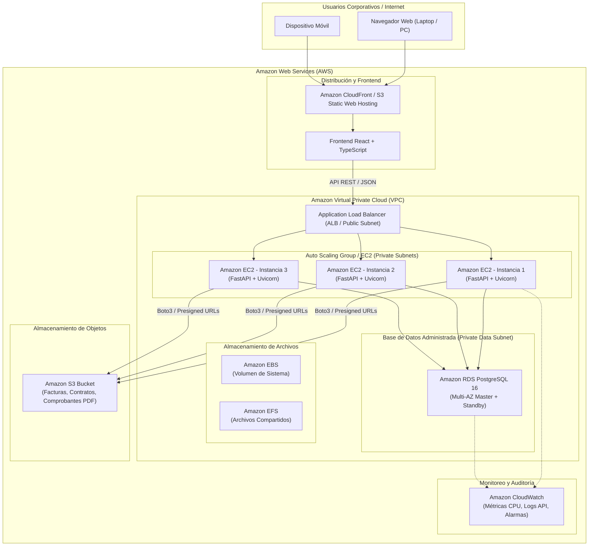

# 05_AWS — Arquitectura Cloud con AWS (Semana 07)
## Sistema de Gestión Empresarial ERP EnterpriseCloud

> **Objetivo Curricular Semana 07:** Implementa servicios en la nube con énfasis en computación (Amazon EC2), almacenamiento (Amazon S3 / EBS / EFS) y bases de datos relacionales administradas (Amazon RDS PostgreSQL).

---

## 🏛️ 1. Diagrama de Arquitectura Cloud (Sección 16 y 21)

---

## ☁️ 2. Mapeo de Servicios de la Semana 07

| Servicio AWS | Categoría | Función en el ERP EnterpriseCloud |
| :--- | :--- | :--- |
| **Amazon EC2** | Cómputo | Ejecución escalable del backend FastAPI en instancias Ubuntu Linux. |
| **Application Load Balancer (ALB)** | Red y Escalabilidad | Distribución de carga equitativa entre múltiples instancias EC2 (`EC2-1`, `EC2-2`, `EC2-3`). |
| **Amazon S3** | Almacenamiento de Objetos | Repositorio seguro para facturas, cotizaciones, órdenes de compra y documentos PDF. |
| **Amazon EBS** | Almacenamiento de Bloques | Disco de alto rendimiento (SSD gp3) montado para el sistema operativo en cada EC2. |
| **Amazon EFS** | Sistema de Archivos | File system compartido para subprocesos batch cuando se requiera. |
| **Amazon RDS (PostgreSQL)** | Base de Datos Relacional | Motor PostgreSQL 16 administrado con copias de seguridad automáticas y alta disponibilidad. |
| **Amazon CloudWatch** | Monitoreo y Observabilidad | Centralización de logs de la aplicación, métricas de CPU/RAM y alertas de salud. |
